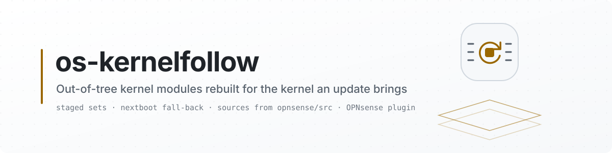

<picture>
  <source media="(prefers-color-scheme: dark)" srcset="docs/images/readme/banner-dark.svg">
  <source media="(prefers-color-scheme: light)" srcset="docs/images/readme/banner-light.svg">
  
</picture>

<p align="center">
  <a href="https://github.com/AbdelmonemAwad/os-kernelfollow/releases/latest"></a>
  <a href="https://github.com/AbdelmonemAwad/os-kernelfollow/actions/workflows/checks.yml"></a>
  <a href="LICENSE"></a>
  <a href="#what-is-tested"></a>
  <a href="https://github.com/AbdelmonemAwad/opnsense-arabic"></a>
  <a href="https://github.com/AbdelmonemAwad/os-xgs-npu"></a>
  <br>
  <a href="#what-is-tested"></a>
  <a href="#what-is-tested"></a>
  <a href="#what-is-tested"></a>
</p>

# Kernel Follower for OPNsense

Rebuilds an out-of-tree FreeBSD kernel module for the kernel an OPNsense update installs, before the reboot, and holds the reboot until it is built - so a driver outside OPNsense's own repository is there on the next boot.

> ~~**Planned - nothing here runs yet.** This repository was opened on 2026-10-22 to hold
> Kernel Follower as a plugin of its own. No code has been written or moved into it, and there is no
> release.~~
>
> ~~**Written, not released (2026-10-22).** The code is here; there is no release, and it has not been
> installed on an appliance yet. What was run is listed under [What is tested](#what-is-tested).~~
>
> **1.0.1 (2026-10-30):** quiet logs, sources fetched with room checked and failed fetches held back, a Check that never waits, kernel.old kept while os-xgs-npu's module needs it, and a page that asks once a refresh. Tested in qemu on OPNsense 26.7.7 before the release; see
> [What is tested](#what-is-tested).
>
> **1.0.0, the first release (2026-10-25).** Installed and its page opened on an XGS 3300 (OPNsense
> 26.7.7) before the release; ~~no real kernel update has been followed yet~~ - since, on 2026-10-29 in
> qemu, it has followed two updates and a major upgrade (see [What is tested](#what-is-tested)).
> Updated from XGS: Updates when os-xgs-npu is installed, or by its own self-update - see
> [Updates](#updates).

<p align="center"><b>Contents:</b> <a href="#what-it-does">What it does</a> &middot; <a href="#beside-os-xgs-npu">Beside os-xgs-npu</a> &middot; <a href="#what-is-tested">What is tested</a> &middot; <a href="#installation">Installation</a> &middot; <a href="#updates">Updates</a> &middot; <a href="#where-it-fits">Where it fits</a> &middot; <a href="#licence">Licence</a></p>

## What it does

- **reads the kernel the next boot will use** - a kernel set an update has staged but not applied
  yet, or `/boot/kernel` - out of the binary, without booting it, and compares it with the stamp
  beside each module registered with it;
- **rebuilds a module that does not match**: that kernel's sources, from an archive carried on the
  machine or from `github.com/opnsense/src` at the commit the kernel names (only `sys/` kept) - since
  2026-10-29 only with 800 MB free under `/usr`, never leaving a tree half written, and, after a
  failed fetch, with an hour before the five-minute run fetches the same sources again (the hooks
  and **Follow now** fetch at once); the
  build from nothing, in a directory emptied first; checked to have compiled every source with the
  machine headers of that kernel; installed under a temporary name and moved into place, stamped,
  the previous build kept beside it as `.prev` with its own stamp;
- **runs when it matters**: the upgrade hook, the stop hook of every orderly reboot (at most ten
  minutes, so a fetch that will not finish never holds the machine), and cron every five minutes.
  With nothing registered each of these is a directory listing; with nothing to do, the log hears
  so once a boot and again when something changes, not at every tick (since 2026-10-29);
- **for a module the network needs** (`CRITICAL=yes`), when it cannot be rebuilt, sends the next
  boot to `/boot/kernel.old`, which the installed module matches, with `nextboot -k` - one shot -
  and cancels that itself once the module is rebuilt;
- **removes the sources of kernels no longer run** once the new kernel has run a day (a setting),
  with every module matching it and attached;
- **System: Kernel Follower** (XGS: Kernel Follower when os-xgs-npu is installed): the kernel
  running and the one the next boot takes, each module against it and what the last run did with
  it, the sources on disk, ~~the last run~~ the output of the last **Follow now** (in a tab of its
  own, called Last run until 2026-10-29 although nothing else wrote to it), **Check** (what a run
  would do) and **Follow now**.

A plugin registers its module with one file in `/usr/local/etc/kernelfollow.d/` -
[docs/registering.md](docs/registering.md).

## Beside os-xgs-npu

The code came from os-xgs-npu's kernel follower (`install/kernel-follow.sh`, its fetcher, the cron
entry and the upgrade and stop hooks), made to serve any module. os-xgs-npu has not been changed:
its follower still runs where it is installed, for its own two modules. So while it is installed
this plugin:

- leaves `octep.ko` and `npuep.ko` to it, and only shows them;
- touches `nextboot` only to cancel a fall-back it set itself, ~~never one os-xgs-npu set~~ and not
  while `octep.ko` or `npuep.ko` is built for another kernel than the one to follow: `nextboot`
  holds one fall-back for the whole host, and os-xgs-npu sets the same one, so cancelling this
  plugin's could cancel os-xgs-npu's (since 2026-10-29);
- leaves the extracted kernel sources in `/usr/src-*` for os-xgs-npu to remove.

When os-xgs-npu hands its modules over is its owner's decision; nothing here changes it.

## What is tested

On the second XGS 3300, 2026-10-22, from a copy in `/tmp`, nothing installed, kernel
`stable/26.7-n284159-abbbe67a45e7` running and on disk:

- `status.py`: the kernel running and the next boot's read the same; os-xgs-npu's `octep.ko`
  stamped for it, with its `.prev` for the p1 kernel; one source tree on disk;
- `follow.sh` with a registration for `octep.ko`: left to os-xgs-npu;
- a small test module registered in `/tmp`: not installed - nothing done; `FORCE=1` - built
  against `/usr/src-26.7-abbbe67a45e7/sys` (10,944 bytes, an x86-64 ELF), installed and stamped;
  run again - "matches", nothing done; stamp changed to the p1 kernel - rebuilt, the old build kept
  as `.prev` with the p1 stamp; a source that does not compile - the build failed, the installed
  module unchanged (same MD5), the result recorded as failed, and with `CRITICAL=yes` the fall-back
  reached (`nextboot` withheld for the test); switched off - nothing done; nothing registered - no
  output at all;
- every PHP file passes `php -l`; both Volt templates compile; every shell script passes `sh -n`.

On the first XGS 3300, 2026-10-25, OPNsense 26.7.7 with os-xgs-npu installed, before the release:

- installed by `install/install.sh`: rc 0, its PHP passing `php -l` in the installer;
- the page opened in the browser, its summary cards reading the status;
- its menu place: under **XGS** with os-xgs-npu installed; in its own section, **System**, when
  os-xgs-npu's menu file was set aside, and back under XGS when it was put back (`place-menu.sh`).

On a plain OPNsense in qemu, 2026-10-29: the 26.7 nano image, kernel 15.1-RELEASE-p1, with nothing
of os-xgs-npu on it. Its WAN reached the internet. A small test module, `kfhello`, was registered as
[docs/registering.md](docs/registering.md) says; it does nothing but load and set
`debug.kfhello`.

- **The package.** `os-kernelfollow-1.0.0.pkg` and `SHA256SUMS` were fetched from the release and
  the sum checked OK. `pkg add` returned 0, and the page is under System > Kernel Follower.
- **A first build.** `FORCE=1 follow.sh` fetched p1's `sys/` from github.com/opnsense/src into
  `/usr/src-26.7-12334a596709` in about a minute, built the module (11,968 bytes), stamped it for
  p1, and it loaded.
- **A real kernel update.** OPNsense 26.7 was updated to 26.7.7 the way the page's Update does it
  (`configctl firmware update`). Its reboot runs the stop scripts before `shutdown`
  (`rc.reboot`). Before that reboot the module was rebuilt for the new kernel: p4's sources were
  fetched over the network into `/usr/src-26.7-abbbe67a45e7`, the module was stamped
  `15.1-RELEASE-p4`, and the p1 build was kept as `kfhello.ko.prev` with its own stamp. The result,
  "rebuilt for the kernel to follow", was recorded at 16:15:36, the second the shutdown began. The
  machine came up on p4, and the module loaded.
- **`nextboot` itself.** The p1 build was put back as the installed module, the registration set to
  `CRITICAL=yes`, and the source broken. `follow.sh` failed the build, left the module untouched
  (same MD5), and wrote `nextboot_enable="YES"`, `kernel="kernel.old"`. The next boot took
  `/boot/kernel.old` (the loader's menu showed "kernel.old (1 of 2)"), ran p1, and loaded the
  module. With the source put back, `follow.sh` built for p4, kept the p1 build as `.prev`, and said
  "the fall-back to kernel.old this plugin set is cleared". The boot after that ran p4.
- **Pruning.** It ran on p4 with the module attached, using `SETTLE=60` in place of the hours
  setting, whose least is an hour. It removed `/usr/src-26.7-12334a596709` - "the sources of a
  kernel this host no longer runs" - and kept p4's.

On a third machine in qemu the same day: the nano image of OPNsense 26.1.6, kernel 14.3-RELEASE-p10,
its `/var/log` moved onto the disk (System: Settings: Miscellaneous) so that the log of every boot
stayed. Kernel Follower 1.0.0 was installed by hand from its release - the source GitHub serves for
the tag, with its `install/install.sh`, as [Installation](#installation) says (the package is built
for 26.7's FreeBSD 15) - and `kfhello` registered and built for the running kernel.

- **An update.** The page's Update took it to 26.1.11 (14.3-RELEASE-p16) and rebooted it. After the
  reboot the module was stamped for p16, the p10 build kept as `.prev`, and it loaded.
- **A major upgrade, and a staged set.** System: Firmware's upgrade took it from 26.1.11 to 26.7
  (`configctl firmware upgrade`: `opnsense-update -u`, then the upgrade hooks, then the pending
  kernel applied, then a reboot). At this plugin's upgrade hook the 26.7 kernel was still a set
  waiting in `/var/cache/opnsense-update/.sets.pending`. The log reads `kernel to follow: FreeBSD
  15.1-RELEASE-p4 stable/26.7-n284159-abbbe67a45e7 SMP (staged, waiting to be applied)`. The module
  was built against `/usr/src-26.7-abbbe67a45e7`, the sources fetched for that kernel, the 26.1.11
  build kept as `.prev`, and the new one installed - all before the upgrade installed the kernel
  itself. After the upgrade's reboots the machine ran OPNsense 26.7.7 on that kernel; the module's
  stamp matched it, and it loaded. Three later runs, two before the reboot and one after it, found
  the stamp matching and changed nothing.
- **Which run rebuilds at an ordinary update.** On the same machine, 2026-10-29, with `/var/log` on
  the disk: an ordinary update (`configctl firmware update`, 26.1.6 to 26.1.11) rebooted the machine
  by itself, and Kernel Follower ran at 18:47:53 - not a five-minute mark - read the newly installed
  p16 `/boot/kernel/kernel`, built and installed the module by 18:48:48, and the machine then
  rebooted: the stop script at the update's reboot rebuilt it.

Not tested: ~~installing it, the page in a browser~~ (both on 2026-10-25, above), ~~a real kernel
update (fetch over the network, the hooks~~ on 2026-10-29 in qemu, above; ~~a staged set, which a
major upgrade leaves, not yet)~~ (on 2026-10-29 in qemu, above), ~~`nextboot` itself, pruning, the
package (built by `tools/make-package.sh`, added with pkg), and an install on a plain OPNsense,
without os-xgs-npu~~ (all on 2026-10-29 in qemu, above). ~~Which of the stop script and the
five-minute cron rebuilt the module during an update, as against a major upgrade, is not shown: the
system log of that boot did not survive the reboot.~~ It was the stop script: measured on the 26.1
machine with `/var/log` on the disk, 2026-10-29 (above).

## Installation

It is not in the OPNsense plugin repository, so there is no `pkg install os-kernelfollow`.

**From a checkout** of this repository, on the firewall, as root:

```sh
sh install/install.sh
```

It copies `src/` onto `/usr/local` (the cron entry and the upgrade and stop hooks with it), checks
the PHP with `php -l` and the Python with `py_compile`, puts the page in the menu (`place-menu.sh`:
XGS with os-xgs-npu, System without) and records the commit for the self-update. Safe to run again:
the settings in config.xml are kept. Archives of kernel sources in `kernel-sources/` beside the
checkout are copied into the pool, so a machine without internet can build.
`sh install/uninstall.sh` removes the plugin and keeps the registrations, the modules and the
sources.

**From a release's package.** A release carries `os-kernelfollow-<version>.pkg` and `SHA256SUMS`,
built by `tools/make-package.sh` in the release workflow; ~~installing it has not been tested yet~~
it was installed with `pkg add` on a plain OPNsense 26.7 on 2026-10-29 - see
[What is tested](#what-is-tested). Check it and read it before adding it, as root:

```sh
sha256sum -c SHA256SUMS
pkg info -lF os-kernelfollow-*.pkg       # every file it will write
pkg add os-kernelfollow-*.pkg
```

`pkg delete os-kernelfollow` keeps the settings, the registrations in `/usr/local/etc/kernelfollow.d`
with the modules they name, and the kernel sources in `/usr/src-*`. The same package is built on
the firewall from a checkout with `sh tools/make-package.sh -o /tmp`.

## Updates

Taken by hand, to this repository's **releases**: from **XGS: Updates**, its *Plugins* tab, where an
[os-xgs-npu](https://github.com/AbdelmonemAwad/os-xgs-npu) that lists this plugin is installed - the
tab calls `/usr/local/opnsense/scripts/kernelfollow/self-update.py`, with `check` to ask and without
it to install - or by running that script. The plugin's cron entry runs the follower every five
minutes, never the self-update; no cron entry runs that. It asks GitHub for the latest release and,
when that is ahead of what is installed, downloads it and runs the `install/install.sh` it carries -
the same script a hand install runs. A change merged on `main` reaches an installed firewall when it
is released, not before.

- **Only forward.** What is installed is recorded in `/usr/local/share/os-kernelfollow/installed.json`
  by the installer: the commit, from a git checkout or from the `.source-commit` stamp an update
  leaves in the tree. A firewall running something newer than the release is not taken back; an
  install with no commit recorded takes the latest release once.
- **A package install records no commit**, so its first self-update takes the latest release and
  installs it with `install/install.sh`, outside pkg. A package is updated with a newer package
  instead: `pkg add -f`.
- **What happened** is in the system log as `self-update`, in
  `/usr/local/share/os-kernelfollow/update.json`, and the installer's output in `update.log` beside it.
- `self-update.py check` says what it would do and changes nothing.

~~Not tested yet: an update taken this way - 1.0.0 is the first release, so none has been ahead of
an installed copy.~~ Tested on 2026-10-29 on a plain OPNsense 26.7 in qemu, where the package had
been added with pkg, which records no commit: `self-update.py check` found the release `v1.0.0`
(d281f36b4cd9) and nothing installed to compare it with, so to be taken. `self-update.py` fetched
its source, ran its `install/install.sh` and answered `updated to v1.0.0 (d281f36b4cd9)`, which the
system log has too. `installed.json` then recorded that commit, from the stamp, and a second check
found it identical: nothing to take. ~~Not yet: a release ahead of the one installed - 1.0.0 is
still the only release.~~ Taken on 2026-10-30, on an XGS 3300 with OPNsense 26.7.7: with 1.0.0
installed, `self-update.py`, run over SSH, answered `updated to v1.0.1 (244ef6257311)`, the system
log carries the same line, and `installed.json` recorded that commit.

## Where it fits

It is one part of the [os-xgs-npu](https://github.com/AbdelmonemAwad/os-xgs-npu) project, which puts OPNsense on Sophos XGS hardware, and works the way its other plugins do: changes by pull request, a release installed from **XGS: Updates** (listed there since os-xgs-npu 0.1.0-alpha.8, and installed with the project's update since 0.1.0-alpha.8.2), its Arabic in [opnsense-arabic](https://github.com/AbdelmonemAwad/opnsense-arabic)'s catalogue.

## Licence

BSD 2-Clause - see [LICENSE](LICENSE).
